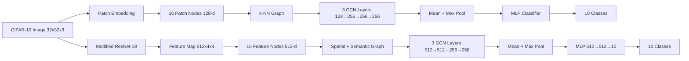

# GCN for Image Classification on CIFAR-10

Academic computer-vision project exploring **Graph Convolutional Networks (GCN)** for image classification by representing image regions as graph nodes.

The project implements and compares two approaches:

1. **Patch-GCN** — split each CIFAR-10 image into patches, convert patches to graph nodes, build a k-NN graph, then classify with GCN layers.
2. **CNN-GCN** — use a modified ResNet-18 to extract a `512 × 4 × 4` feature map, treat the 16 spatial locations as graph nodes, combine spatial and semantic edges, and classify with GCN layers.

> Academic topic: **Application of Graph Convolutional Network in Computer Vision for Image Classification**  
> Dataset: **CIFAR-10**  
> Framework: **PyTorch**

## Project Architecture



## Workflow Figures from the Academic Report

### Patch-GCN


### CNN-GCN


## Reported Results

These are the results stated in the academic report after 30 epochs.

| Model     | Test Loss | Accuracy | Precision | Recall | F1-score |
| --------- | --------: | -------: | --------: | -----: | -------: |
| Patch-GCN |    1.2137 |   56.79% |    56.58% | 56.79% |   56.21% |
| CNN-GCN   |    0.2651 |   92.06% |    92.04% | 92.06% |   92.04% |

The report also evaluates semantic k-NN values `k = 2, 4, 6` for CNN-GCN and reports the best result at **k = 2**.

## Dataset

CIFAR-10 contains:

- 60,000 RGB images
- image size: `32 × 32`
- 50,000 training images
- 10,000 test images
- 10 classes: `airplane`, `automobile`, `bird`, `cat`, `deer`, `dog`, `frog`, `horse`, `ship`, `truck`

The report states that the first **1,000 training images** were selected for the experiment, while evaluation figures use the full **10,000-image test set**. This repository exposes the subset size as a command-line option.

## Model 1 — Patch-GCN

```text
CIFAR-10 image (32×32×3)
        ↓
4×4 patches, each 8×8×3
        ↓
16 graph nodes
        ↓
Flatten 192 → Linear embedding 128
        ↓
Spatial k-NN graph
        ↓
GCN 128 → 256 → 256 → 256
        ↓
Global Mean Pool + Global Max Pool
        ↓
512-d image representation
        ↓
MLP 512 → 512 → 10
        ↓
CIFAR-10 class
```

## Model 2 — CNN-GCN

```text
CIFAR-10 image (32×32×3)
        ↓
Modified ResNet-18
(conv1=3×3, stride=1, maxpool removed)
        ↓
Feature map 512×4×4
        ↓
16 graph nodes × 512 features
        ↓
Spatial edges + semantic k-NN edges
        ↓
GCN 512 → 512 → 256 → 256
        ↓
Global Mean Pool + Global Max Pool
        ↓
512-d image representation
        ↓
MLP 512 → 512 → 10
        ↓
CIFAR-10 class
```

## Installation

```bash
python -m venv .venv
```

Windows:

```bash
.venv\Scripts\activate
```

Install dependencies:

```bash
pip install -r requirements.txt
```

## Train Patch-GCN

```bash
python train.py --model patch_gcn --epochs 30 --batch-size 128 --learning-rate 1e-3 --train-subset 1000 --k 4
```

## Train CNN-GCN

```bash
python train.py --model cnn_gcn --epochs 30 --batch-size 128 --learning-rate 1e-3 --train-subset 1000 --k 4
```

Optional ImageNet-pretrained ResNet-18:

```bash
python train.py --model cnn_gcn --pretrained-backbone
```

Pretraining is disabled by default because the report does not clearly establish whether pretrained weights were used.

## Optimize k

```bash
python scripts/sweep_k.py --model cnn_gcn --values 2 4 6
```

## Evaluate a Checkpoint

```bash
python evaluate.py --model cnn_gcn --checkpoint results/runs/cnn_gcn/best.pt
```

## Outputs

```text
results/runs/<model>/
├── best.pt
├── history.csv
├── metrics.json
├── loss_curve.png
├── accuracy_curve.png
└── confusion_matrix.png
```

## Repository Structure

```text
gcn-image-classification-cifar10/
├── README.md
├── requirements.txt
├── train.py
├── evaluate.py
├── configs/
├── src/
│   ├── data.py
│   ├── graph.py
│   ├── engine.py
│   ├── metrics.py
│   ├── plotting.py
│   ├── utils.py
│   └── models/
├── scripts/
├── docs/
├── assets/
├── results/
└── tests/
```
