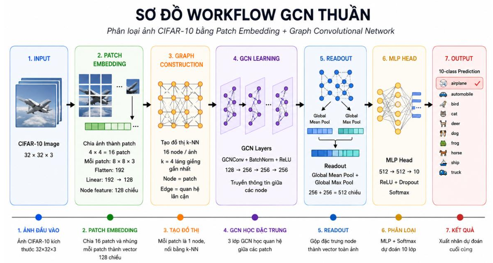
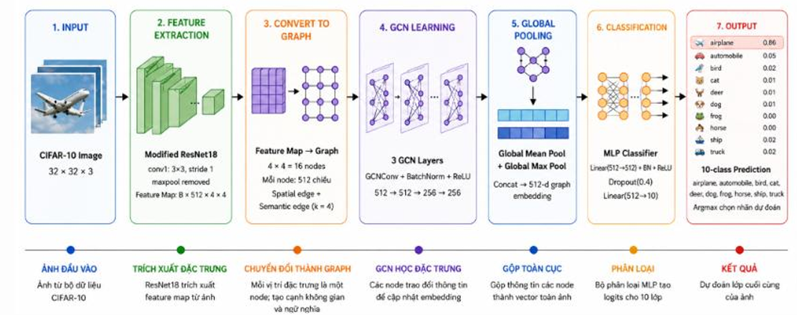

# Architecture

## Patch-GCN

```text
Image
→ 8×8 patches
→ 16 nodes
→ Linear patch embedding (192→128)
→ k-NN graph
→ 3 GCN layers (128→256→256→256)
→ Global Mean Pool + Global Max Pool
→ 512-dimensional image representation
→ MLP (512→512→10)
```



## CNN-GCN

```text
Image
→ Modified ResNet-18
→ Feature map 512×4×4
→ 16 nodes × 512 features
→ Spatial graph + semantic k-NN graph
→ 3 GCN layers (512→512→256→256)
→ Global Mean Pool + Global Max Pool
→ MLP (512→512→10)
```


